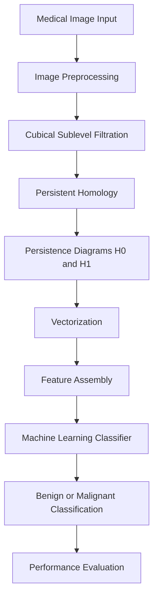

# 🧬 MammoMinds
<h1 align="center">Persistence Image-Based Topological Machine Learning for Breast Cancer Detection</h1>

<p align="center">
  <b>An explainable machine-learning framework using Persistent Homology and Topological Data Analysis for breast-image classification.</b>
</p>

<p align="center">
  
  
  
  
  
</p>

---

## 📌 Overview

**MammoMinds** is a research project that explores Topological Data Analysis (TDA) and machine learning for the classification of breast lesions as benign or malignant using mammography and ultrasound images.

The project uses **Persistent Homology** to extract topological information from medical images. These features are transformed into machine-learning-ready representations and evaluated using different supervised classifiers.

Unlike conventional deep-learning approaches that may operate as black boxes, this project investigates mathematically grounded topological representations of image structure.

---

## 📑 Table of Contents

- [Overview](#-overview)
- [Problem Statement](#-problem-statement)
- [Objectives](#-objectives)
- [System Workflow](#-system-workflow)
- [Methodology](#-methodology)
- [Datasets](#-datasets)
- [Technology Stack](#-technology-stack)
- [Results](#-results)
- [Installation](#-installation)
- [Project Structure](#-project-structure)
- [Limitations](#-limitations)
- [Future Work](#-future-work)
- [Research Publication](#-research-publication)
- [Team](#-team)
- [Disclaimer](#-disclaimer)

---

## 🎯 Problem Statement

Breast-image interpretation requires expertise and can be time-consuming. Machine-learning systems may assist in image analysis, but many approaches provide limited interpretability.

This project aims to develop and evaluate an explainable and noise-robust computer-aided diagnostic research pipeline that extracts topological features from mammography and ultrasound images using Persistent Homology and classifies lesions into benign and malignant categories.

---

## 🎯 Objectives

- Extract topological features from medical images using cubical sublevel-set filtrations.
- Analyze connected components (H₀) and loops (H₁).
- Transform persistence diagrams into fixed-length feature vectors.
- Compare four persistence-diagram vectorization techniques.
- Evaluate Random Forest, XGBoost, SVM and KNN classifiers.
- Evaluate performance using accuracy, precision, recall, F1-score and ROC-AUC.
- Investigate the contribution of H₀ and H₁ through an ablation study.
- Develop a reproducible and modular research pipeline.

---

## 🔬 System Workflow



### Pipeline stages

| Stage | Description |
|---|---|
| Image Input | Mammography ROI crops or ultrasound images |
| Preprocessing | Image resizing and intensity normalization |
| Filtration | Construction of cubical sublevel-set filtration |
| Topological Analysis | Computation of H₀ and H₁ persistence diagrams |
| Vectorization | Conversion of diagrams into numerical representations |
| Feature Assembly | Combining H₀ and H₁ feature representations |
| Classification | Training and prediction using machine-learning classifiers |
| Evaluation | Measuring model performance |

---

## 🧠 Methodology

<details>
<summary><b>1. Image Preprocessing</b></summary>

Medical images are processed to standardize their dimensions and intensity values.

- Resize images to 256 × 256 pixels.
- Normalize grayscale intensities to the range [0, 100].
- Prepare images for cubical filtration.

</details>

<details>
<summary><b>2. Cubical Filtration</b></summary>

A cubical complex is constructed from the image grid.

A sublevel set is defined as:

\[
X_t = \{x : f(x) \leq t\}
\]

As the threshold increases, a sequence of nested sublevel sets is generated.

</details>

<details>
<summary><b>3. Persistent Homology</b></summary>

Persistent Homology tracks the birth and death of topological features as the filtration progresses.

- **H₀:** Tracks connected components.
- **H₁:** Tracks loops.

The resulting persistence diagrams capture structural information across multiple thresholds.

</details>

<details>
<summary><b>4. Persistence Diagram Vectorization</b></summary>

Four vectorization methods are investigated:

| Method | Description |
|---|---|
| Betti Curves | Tracks the number of features alive at each threshold |
| Persistence Landscapes | Represents persistence points through tent functions |
| Persistence Silhouettes | Weighted summary of persistence landscape functions |
| Persistence Images | Gaussian-weighted representation on a regular grid |

The persistence-image representation uses a 20 × 20 grid for each homology dimension.

\[
2 \times (20 \times 20) = 800
\]

The combined H₀ and H₁ persistence-image feature vector contains **800 features**.

</details>

<details>
<summary><b>5. Classification</b></summary>

The project evaluates four supervised learning algorithms:

- Random Forest
- XGBoost
- Support Vector Machine (SVM)
- K-Nearest Neighbors (KNN)

Random Forest and XGBoost are the primary classifiers investigated.

</details>

<details>
<summary><b>6. Evaluation</b></summary>

The system is evaluated using:

- Accuracy
- Precision
- Recall
- F1-score
- ROC-AUC

Five-fold cross-validation and model comparisons are used in the experimental evaluation described in the report.

</details>

---

## 🗂️ Datasets

### 1. CBIS-DDSM

**Curated Breast Imaging Subset of the Digital Database for Screening Mammography**

| Attribute | Details |
|---|---|
| Imaging modality | Mammography |
| Total images | 1,696 ROI crops |
| Benign | 912 |
| Malignant | 784 |
| Image resolution | 1024 × 1024 |

### 2. BUSI

**Breast Ultrasound Images Dataset**

| Attribute | Details |
|---|---|
| Imaging modality | Ultrasound |
| Total images | 780 |
| Benign | 437 |
| Malignant | 210 |
| Normal | 133 |

For binary classification, the study uses 647 benign and malignant lesion images, excluding normal images.

<sub>Dataset statistics are based on the project report.</sub>

---

## 🛠️ Technology Stack

| Technology | Purpose |
|---|---|
| Python | Core programming language |
| Giotto-TDA | Topological feature extraction and persistence representations |
| Scikit-learn | Machine-learning classifiers and evaluation |
| XGBoost | Gradient-boosting classification |
| NumPy | Numerical computation |
| Pandas | Data processing |
| Jupyter Notebook | Experimental development |
| Visual Studio Code | Development environment |
| Git & GitHub | Version control |

---

## 📊 Results

### CBIS-DDSM — Conference paper results

The accepted conference paper reports the following accuracy comparison across persistence-diagram vectorization methods.

| Vectorization Method | Accuracy |
|---|---:|
| Betti Curves | 94.3% |
| Persistence Silhouettes | 94.5% |
| Persistence Landscapes | 94.9% |
| **Persistence Images** | **95.8%** |

<details>
<summary><b>View result interpretation</b></summary>

Persistence images combined with both homology dimensions achieved the highest reported accuracy among the four vectorization methods in the CBIS-DDSM evaluation.

</details>

### BUSI — Logged evaluation

The project report also documents a patient-grouped hold-out evaluation on the BUSI dataset.

| Metric | Reported result |
|---|---:|
| Accuracy | 86.92% |
| ROC-AUC | 0.922 |

<details>
<summary><b>Important: Different evaluation results</b></summary>

The project report presents different BUSI evaluation figures for the conference paper and the later logged re-run.

These results are from different evaluation setups and should not be treated as directly interchangeable.

</details>

<sub>Results are research findings reported in the project report and are not independently reproduced by this README.</sub>

---

## ⚙️ Installation

### Prerequisites

- Python
- Git
- pip
- Jupyter Notebook (optional)

### Step 1: Clone the repository

```bash
git clone https://github.com/YOUR_USERNAME/YOUR_REPOSITORY.git
```

```bash
cd YOUR_REPOSITORY
```

### Step 2: Create a virtual environment

```bash
python -m venv venv
```

**Windows**

```bash
venv\Scripts\activate
```

**macOS / Linux**

```bash
source venv/bin/activate
```

### Step 3: Install dependencies

If your repository contains a `requirements.txt`:

```bash
pip install -r requirements.txt
```

Otherwise, the dependencies listed in the report can be installed as a starting point:

```bash
pip install numpy pandas scikit-learn xgboost giotto-tda matplotlib
```

<sub>Dependency versions and installation commands should be adjusted to match the actual repository and environment.</sub>

---

## 📁 Project Structure

```text
MammoMinds/
│
├── README.md
├── requirements.txt
├── data/
│   ├── CBIS-DDSM/
│   └── BUSI/
│
├── notebooks/
│   └── experiments.ipynb
│
├── src/
│   ├── preprocessing.py
│   ├── pipeline.py
│   ├── feature_extraction.py
│   ├── vectorization.py
│   └── classification.py
│
├── results/
│   ├── metrics/
│   └── figures/
│
└── docs/
    └── project_report.pdf
```

<sub>This is a suggested documentation layout, not a verified listing of the ZIP repository.</sub>

---

## ⚠️ Limitations

- The project focuses on binary classification of benign and malignant lesions.
- The experiments use public benchmark datasets.
- The pipeline is based on topological features rather than deep neural networks.
- The reported results have not been clinically validated.
- The system is not a medical device.
- Predictions must not be used as a substitute for professional medical interpretation.

---

## 🚀 Future Work

- Extend the pipeline to additional medical imaging datasets.
- Improve reproducibility through documented configurations and dependency versions.
- Explore additional topological feature representations.
- Investigate feature interpretability and visual analysis.
- Evaluate the framework on additional independent datasets.
- Explore integration of topological and complementary feature representations.

---

## 📄 Research Publication

**Title:** Persistence Image-Based Topological Machine Learning for Breast Cancer Detection

- **Conference:** 2026 IEEE Silchar Subsection Conference (SILCON)
- **Paper ID:** 1084
- **Track:** Artificial Intelligence, Data Science and Computing
- **Status:** Accepted

The project report also documents a copyright application associated with the research.

---

## 👥 Team MammoMinds

| Team Member | Role |
|---|---|
| Aachlesh Chandrashekhar Mule | Team Member |
| Pratik Shivaji Chaudhari | Team Member |
| Saiprasad Vinod Shinde | Team Member |
| Vishwajeet Dhairyashil Kere | Team Member |

**Faculty Guide:** Dr. Mayura Shelke  
**Industry Mentor:** Prasad Nanavare

**Institution:** MIT School of Computing, MIT Art, Design and Technology University, Pune.

---

## 📌 Disclaimer

This repository represents an academic research project involving topological data analysis and machine learning for breast-image classification.

It is intended for research and educational purposes only. It is not clinically validated, is not a medical device, and must not be used to make medical decisions.

---

<p align="center">
  <b>Built with research, mathematics and machine learning by Team MammoMinds 🧬</b>
</p>

